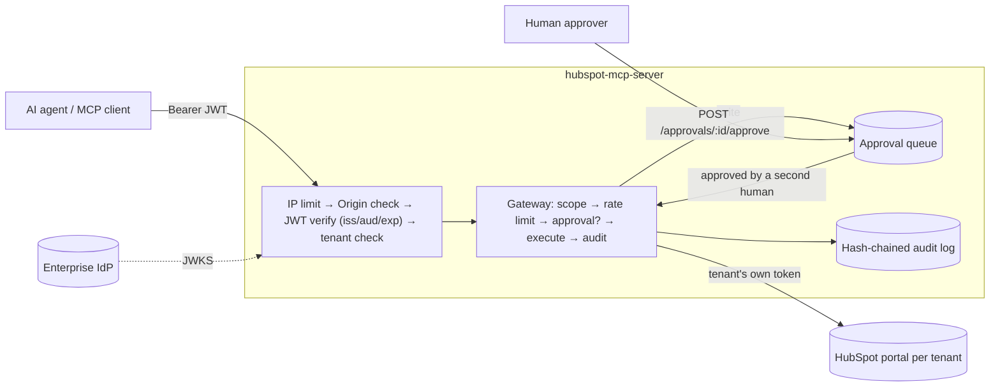

# HubSpot MCP Server

[](https://github.com/djmoore-projects/hubspot-mcp-server/actions/workflows/ci.yml)
[](LICENSE)
[](package.json)

A production-grade, **remote** Model Context Protocol server that lets AI agents (Claude, Cursor, any MCP client) read and write HubSpot CRM data. It is built for regulated environments such as fintech, where a security team has to be able to say yes:

| Control | What it does |
|---|---|
| **Remote transport** | Stateless Streamable HTTP at `/mcp`. It needs no sticky sessions and runs behind any load balancer. stdio is kept for local use. |
| **OAuth 2.1** | The server is a resource server for *your* IdP (Okta, Entra ID, Auth0, Keycloak). It validates JWTs against JWKS and checks issuer, **audience** (RFC 8707) and expiry. It advertises the IdP through RFC 9728 protected-resource metadata. |
| **Multi-tenancy** | A tenant claim in the token selects that tenant's own HubSpot credential. Cross-tenant reads are impossible by construction, and unknown tenants are rejected. |
| **Per-user scopes** | Each tool needs a scope. Users only *see* the tools they're scoped for, and scope is re-checked on every call. |
| **Human approval** | Write tools never run directly. They create a pending approval that a **different** human with `hubspot:approvals:review` must approve (four-eyes). Approval is out of band, so an agent can never approve its own writes. |
| **Audit logging** | An append-only, **hash-chained** JSONL trail of every call, denial, approval and execution. PII is pseudonymized. `npm run audit:verify` detects tampering. |
| **Rate limiting** | Token buckets per tenant, per user (reads and writes separately) and per IP before auth. |
| **Hardening** | Origin allow-list (DNS-rebinding protection), 256 KB body cap, strict input schemas, HSTS/no-store headers, a non-root distroless image, and no token passthrough. |
| **Deploy** | Dockerfile, a one-command Cloud Run script (plus a Cloud Run Button) and `fly.toml`. |

## Architecture



```
src/
  index.ts          entrypoint: stdio or http
  config.ts         env + tenant registry validation (fails fast on missing secrets)
  auth.ts           JWT verifier (jose + remote JWKS), scope/tenant extraction
  http.ts           Express app: /mcp, OAuth metadata, approvals API, health
  gateway.ts        guardrail pipeline + per-principal MCP server construction
  tools.ts          tool catalog: schema, required scope, read/write kind
  approvals.ts      approval queue (tenant-scoped)
  audit.ts          hash-chained audit logger, PII redaction, chain verifier
  rateLimit.ts      token-bucket limiter
  hubspotClient.ts  HubSpot REST wrapper (429 retry, typed errors)
  dev/issuer.ts     local mock IdP for development and tests
```

## Scopes

| Scope | Grants |
|---|---|
| `hubspot:contacts:read` | `hubspot_get_contact` |
| `hubspot:companies:read` | `hubspot_search_companies` |
| `hubspot:contacts:write` | `hubspot_create_contact` (subject to approval) |
| `hubspot:activities:write` | `hubspot_log_activity` (subject to approval) |
| `hubspot:approvals:review` | approval API. **Grant to people, never to agent clients.** |

Scopes are read from `scope` (space-delimited), `scp` or `permissions`, which covers Okta, Entra ID and Auth0. The tenant comes from the claim named by `OAUTH_TENANT_CLAIM` (default `tenant_id`). In Okta or Auth0, add it as a custom claim; in Entra ID, use an optional claim or `tid`.

## Quick start (local, no IdP needed)

```bash
npm install && npm run build
```

Terminal 1 starts a throwaway issuer and prints tokens for an analyst, an agent and an approver:

```bash
npm run dev:issuer
```

Terminal 2:

```bash
MCP_TRANSPORT=http OAUTH_ISSUER=http://127.0.0.1:9999 OAUTH_JWKS_URI=http://127.0.0.1:9999/.well-known/jwks.json TENANTS_JSON='{"acme":{"hubspotTokenEnv":"HUBSPOT_TOKEN_ACME"}}' HUBSPOT_TOKEN_ACME=pat-xxxx AUDIT_LOG_FILE=./audit.jsonl npm start
```

Then, as the agent, request a write. It comes back as `pending_approval` with an `approvalId`:

```bash
curl -s localhost:8080/mcp -H "Authorization: Bearer $AGENT" -H 'Content-Type: application/json' -H 'Accept: application/json, text/event-stream' -d '{"jsonrpc":"2.0","id":1,"method":"tools/call","params":{"name":"hubspot_create_contact","arguments":{"email":"jane@example.com"}}}'
```

As the approver, review the queue and approve:

```bash
curl -s localhost:8080/approvals -H "Authorization: Bearer $APPROVER"
```

```bash
curl -s -X POST localhost:8080/approvals/apr_.../approve -H "Authorization: Bearer $APPROVER" -H 'Content-Type: application/json' -d '{"reason":"KYC verified"}'
```

Finally, check the audit trail:

```bash
npm run audit:verify -- ./audit.jsonl
```

## Approval API

All routes require a token with `hubspot:approvals:review`. Every route is scoped to the approver's own tenant.

| Route | |
|---|---|
| `GET /approvals?status=pending` | List requests with full arguments, so the approver sees exactly what will run |
| `GET /approvals/:id` | One request |
| `POST /approvals/:id/approve` `{reason?}` | Executes the **frozen** arguments from the original request. Returns the result. |
| `POST /approvals/:id/reject` `{reason?}` | Closes the request without executing |

Rules: requesters can't approve their own requests (403, audited). Each request can be decided only once (409). Requests expire after `APPROVAL_TTL_SECONDS`. Agents poll `hubspot_get_approval_status`.

Set `APPROVAL_WEBHOOK_URL` to notify a Slack, Teams or Google Chat channel. The payload is PII-redacted and links to the review URL.

## Audit log

Each record includes `id, ts, prevHash, action, outcome, tenantId, subject, clientId, tool, approvalId, args, reason, durationMs, hash`. Records are written as JSON to **stderr**, where Cloud Logging and Fly log shipping pick them up as structured logs. Set `AUDIT_LOG_FILE` to also write a local file. With `AUDIT_REDACT_PII=true` (the default):

- Emails become `sha256:<16 hex>`, which is still correlatable.
- Names and free-text bodies become `[redacted len=N]`.

For a regulated retention requirement, route the log sink to WORM storage, such as a GCS bucket with a retention lock.

## Deploy

**Cloud Run**:

1. Put each tenant's HubSpot token in Secret Manager.
2. Copy `deploy/cloudrun.env.example.yaml` to `deploy/cloudrun.env.yaml` and edit it.
3. Run:

```bash
PROJECT=my-project REGION=us-central1 SECRETS="HUBSPOT_TOKEN_ACME=hubspot-token-acme:latest" ./deploy/cloudrun.sh
```

The service is deployed `--allow-unauthenticated` on purpose: Cloud Run IAM would block OAuth clients, and the app enforces auth itself on every route except `/healthz` and the metadata endpoints. There's also a one-click [Cloud Run Button](https://github.com/GoogleCloudPlatform/cloud-run-button), driven by `app.json`:

[](https://deploy.cloud.run?git_repo=https://github.com/djmoore-projects/hubspot-mcp-server)

**Fly.io**, following the comments in `fly.toml`:

```bash
fly launch --copy-config --no-deploy
```

```bash
fly secrets set OAUTH_ISSUER=... TENANTS_JSON=... HUBSPOT_TOKEN_ACME=... PUBLIC_BASE_URL=https://<app>.fly.dev
```

```bash
fly deploy
```

**Connecting Claude or other clients:** add `https://<host>/mcp` as a remote MCP server or custom connector. The client finds your IdP through `/.well-known/oauth-protected-resource/mcp`. Your IdP needs a client registered for it, or Dynamic Client Registration enabled.

### Scaling out

The approval queue and rate-limit buckets live in memory. The shipped configs therefore pin to **one instance**, which also means pending approvals are lost on restart. To run several replicas, implement `ApprovalStore` and `RateLimiter` on Redis, Firestore or Postgres. Both are small, single-file classes, and the MCP transport itself is already stateless.

## Local stdio mode (Claude Desktop / Cursor)

Unchanged from v1: a single user with their own token and all tool scopes. Approvals are off because there's no second human.

```json
{
  "mcpServers": {
    "hubspot": {
      "command": "node",
      "args": ["/absolute/path/to/hubspot-mcp-server/dist/index.js"],
      "env": { "HUBSPOT_ACCESS_TOKEN": "pat-xxxxx" }
    }
  }
}
```

HubSpot private-app scopes needed: `crm.objects.contacts.read/write`, `crm.objects.companies.read`, plus the engagement write scopes for the activity types you log.

## Configuration

See [.env.example](.env.example) for every variable and its default.

## Tests

```bash
npm test
```

The end-to-end suite runs the real HTTP app against a mock IdP and a fake CRM. It covers:

- 401 discovery and wrong-audience rejection
- unknown-tenant and bad-Origin rejection
- scope-filtered tool lists and tenant routing
- the approval flow: self-approval blocked, cross-tenant 404, double-approve 409, rejected writes never execute
- rate limits
- audit-chain tamper detection and PII absence

## License

MIT — see [LICENSE](LICENSE).
